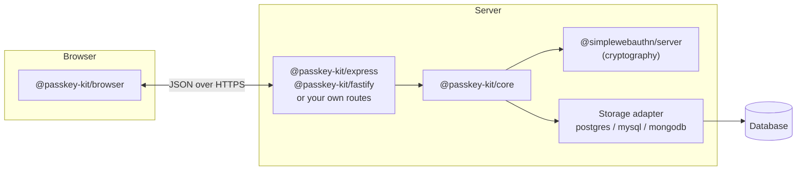
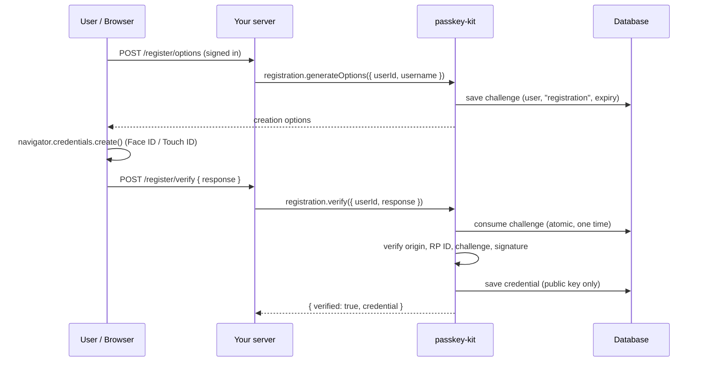
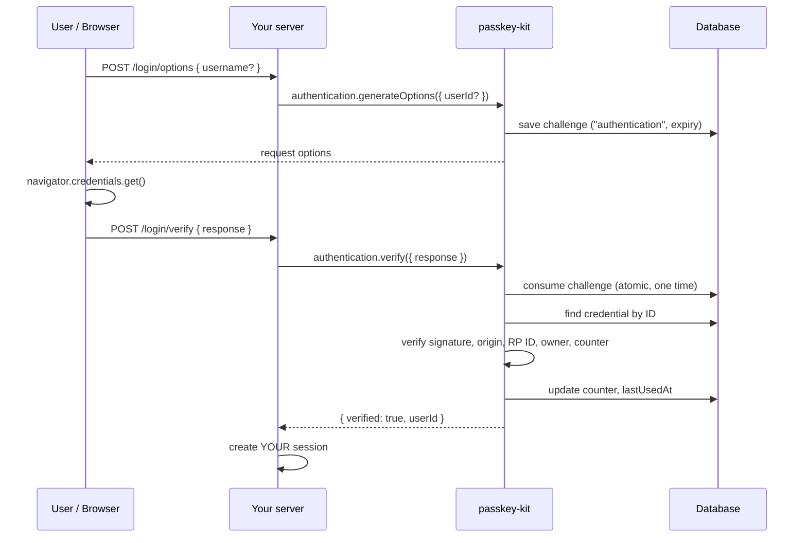

# passkey-kit

Passwordless sign-in with **passkeys** (WebAuthn / FIDO2) for Node.js. TypeScript-first, and it works with any framework and any database.

[](https://github.com/Rukshan2000/passkey-kit/actions/workflows/ci.yml)
[](https://www.npmjs.com/package/@passkey-kit/core)
[](./LICENSE)

```ts
const options = await passkey.authentication.generateOptions();
// ...browser shows Face ID / Touch ID / Windows Hello...
const result = await passkey.authentication.verify({ response });
if (result.verified) signIn(result.userId);
```

- **Registration and sign-in**: username-first or usernameless ("Sign in with a passkey", including autofill).
- **Several passkeys per user**: list, rename and revoke them.
- **Secure defaults**: one-time challenges that expire and are tied to a user and a ceremony, ownership checks, replay and cloned-authenticator protection.
- **Any database**: PostgreSQL, MySQL and MongoDB adapters, or implement two small interfaces yourself.
- **Any framework**: drop-in Express router and Fastify plugin, or framework-free handlers for anything else (Next.js, Hono, plain `node:http`).
- **Built on [SimpleWebAuthn](https://simplewebauthn.dev)** for the cryptography. passkey-kit doesn't roll its own crypto.

## Contents

- [What is a passkey?](#what-is-a-passkey)
- [Packages](#packages)
- [Installation](#installation)
- [Quick start (Express)](#quick-start-express)
- [Registration flow](#registration-flow)
- [Authentication flow](#authentication-flow)
- [Browser SDK](#browser-sdk)
- [Express integration](#express-integration)
- [Fastify integration](#fastify-integration)
- [Other frameworks](#other-frameworks)
- [Database adapters](#database-adapters)
- [Configuration reference](#configuration-reference)
- [Security considerations](#security-considerations)
- [API reference](#api-reference)
- [Error codes](#error-codes)
- [Examples](#examples)
- [Browser compatibility](#browser-compatibility)
- [Contributing](#contributing)

## What is a passkey?

A passkey replaces a password with a key pair. The **private key** never leaves the user's device (phone, laptop, password manager or security key). Your server stores only the **public key**. To sign in, your server sends a random **challenge**, the device signs it after the user unlocks it with a fingerprint, face or PIN, and your server checks the signature.

Nothing secret is stored on your server, so a database leak exposes no credentials. Passkeys are also bound to your domain, which makes them immune to phishing. Biometric data never leaves the device; your server never sees it.

## Packages

| Package | What it does |
| --- | --- |
| [`@passkey-kit/core`](packages/core) | Server logic: options, verification, challenges, credential management |
| [`@passkey-kit/browser`](packages/browser) | Browser SDK that wraps `navigator.credentials` |
| [`@passkey-kit/express`](packages/express) | Express router with all the endpoints |
| [`@passkey-kit/fastify`](packages/fastify) | Fastify plugin with all the endpoints |
| [`@passkey-kit/postgres`](packages/adapters/postgres) | PostgreSQL stores and SQL migration |
| [`@passkey-kit/mysql`](packages/adapters/mysql) | MySQL 8+ stores and SQL migration |
| [`@passkey-kit/mongodb`](packages/adapters/mongodb) | MongoDB stores and indexes |
| [`@passkey-kit/memory`](packages/adapters/memory) | In-memory stores, **for development and tests only** |



## Installation

Requires Node.js 22 or later.

```sh
# Server
npm install @passkey-kit/core @passkey-kit/express @passkey-kit/postgres pg

# Browser (bundled into your frontend)
npm install @passkey-kit/browser
```

Swap `express` for `fastify`, and `postgres pg` for `mysql mysql2` or `mongodb mongodb`, to match your stack.

## Quick start (Express)

**1. Create the tables** (PostgreSQL shown):

```sh
psql "$DATABASE_URL" -f node_modules/@passkey-kit/postgres/migrations/001_init.sql
```

**2. Configure passkey-kit and mount the router:**

```ts
import express from 'express';
import session from 'express-session';
import { Pool } from 'pg';
import { Passkey } from '@passkey-kit/core';
import { passkeyRouter } from '@passkey-kit/express';
import { PostgresChallengeStore, PostgresCredentialStore } from '@passkey-kit/postgres';

const pool = new Pool({ connectionString: process.env.DATABASE_URL });

const passkey = new Passkey({
  rpName: 'My App',
  rpID: 'example.com', // your domain, without https:// or a port
  origin: 'https://example.com', // the exact origin your site is served from
  credentials: new PostgresCredentialStore(pool),
  challenges: new PostgresChallengeStore(pool),
});

const app = express();
app.use(session({ secret: process.env.SESSION_SECRET!, resave: false, saveUninitialized: false }));

app.use(
  '/auth/passkey',
  passkeyRouter({
    passkey,
    // Who is signed in right now? Needed to add or manage passkeys.
    getUser: (req) => req.session.user ?? null,
    // Called after a passkey sign-in is verified. Create YOUR session here.
    onAuthenticated: (req, result) =>
      new Promise((resolve, reject) =>
        req.session.regenerate((err) => {
          if (err) return reject(err);
          req.session.user = { id: result.userId, username: lookUpUsername(result.userId) };
          resolve({ verified: true });
        }),
      ),
  }),
);
```

**3. Call it from the browser:**

```ts
import { PasskeyClient } from '@passkey-kit/browser';

const client = new PasskeyClient();
const post = (url: string, body?: unknown) =>
  fetch(url, { method: 'POST', headers: { 'content-type': 'application/json' }, body: JSON.stringify(body ?? {}) }).then((r) => r.json());

// Add a passkey (the user must already be signed in)
const regOptions = await post('/auth/passkey/register/options');
const regResponse = await client.register(regOptions);
await post('/auth/passkey/register/verify', { response: regResponse });

// Sign in with a passkey
const loginOptions = await post('/auth/passkey/login/options');
const loginResponse = await client.authenticate(loginOptions);
await post('/auth/passkey/login/verify', { response: loginResponse });
```

That's everything. For local development use `rpID: 'localhost'` and `origin: 'http://localhost:3000'`, with the memory adapter if you like.

## Registration flow

Registration adds a passkey to an account that already exists. The user signs up first, or signs in another way, and then adds a passkey.



Using `core` directly:

```ts
const options = await passkey.registration.generateOptions({ userId: user.id, username: user.email });
// send options to the browser, get `response` back
const result = await passkey.registration.verify({ userId: user.id, response, name: 'MacBook' });
if (!result.verified) console.warn(result.error.code);
```

Passkeys the user already has are sent as `excludeCredentials`, so the same device isn't registered twice. A user can have any number of passkeys.

## Authentication flow



Two styles are supported:

- **Usernameless** (recommended): call `generateOptions()` with no user. The device offers the user's passkeys for your site. passkey-kit works out who the user is **from the stored credential**, never from what the browser claims.
- **Username-first**: call `generateOptions({ userId })`, and only that user's passkeys are allowed. With the Express or Fastify integration, enable this by passing `findUserIdByUsername`. Unknown usernames quietly get usernameless options, so attackers can't use the endpoint to discover which accounts exist.

A successful `verify` only tells you who the user is. Creating the session (cookie, JWT, …) is your job, in `onAuthenticated` or after calling `verify` yourself.

## Browser SDK

```ts
import { PasskeyClient, PasskeyUnsupportedError } from '@passkey-kit/browser';

const client = new PasskeyClient();

const caps = await client.capabilities();
// { webauthn: boolean, platformAuthenticator: boolean, conditionalMediation: boolean }

const credential = await client.register(registrationOptions);
const assertion = await client.authenticate(authenticationOptions);
```

| Method | Description |
| --- | --- |
| `capabilities()` | Detects WebAuthn, a built-in authenticator (Touch ID, Windows Hello) and autofill support. Never throws. |
| `register(options, { signal? })` | Runs `navigator.credentials.create()` and returns JSON to send to `/register/verify`. |
| `authenticate(options, { signal?, conditional? })` | Runs `navigator.credentials.get()`. `conditional: true` shows passkeys in the browser's autofill. |
| `cancel()` | Cancels a pending ceremony, for example a waiting autofill request before you start a button sign-in. |

**Passkey autofill:** add `autocomplete="username webauthn"` to your username input and start sign-in when the page loads:

```ts
if ((await client.capabilities()).conditionalMediation) {
  const options = await post('/auth/passkey/login/options');
  const response = await client.authenticate(options, { conditional: true });
  await post('/auth/passkey/login/verify', { response });
}
```

**Errors:** `PasskeyUnsupportedError` means the browser has no WebAuthn. A `WebAuthnError` or DOM error named `NotAllowedError` usually means the user cancelled or the prompt timed out. Show a friendly message and let them try again.

Binary fields (`ArrayBuffer`) are converted to and from base64url for you. Send the returned objects to your server as JSON without changing them.

## Express integration

```ts
app.use('/auth/passkey', passkeyRouter({ passkey, getUser, findUserIdByUsername, onAuthenticated }));
```

| Route | Signed in? | Body | Response |
| --- | --- | --- | --- |
| `POST /register/options` | yes | none | creation options |
| `POST /register/verify` | yes | `{ response, name? }` | `{ verified, credential }` |
| `POST /login/options` | no | `{ username? }` | request options |
| `POST /login/verify` | no | `{ response }` | whatever `onAuthenticated` returns |
| `GET /credentials` | yes | none | list of the user's passkeys (no public keys) |
| `DELETE /credentials/:id` | yes | none | `204`, or `404` if not found or not yours |

The router parses JSON itself (64 KB limit) and sets `Cache-Control: no-store`. Tested with Express 5; Express 4.21+ is supported.

## Fastify integration

```ts
import { passkeyPlugin } from '@passkey-kit/fastify';

await app.register(passkeyPlugin, {
  prefix: '/auth/passkey',
  passkey,
  getUser: (req) => req.session.get('user') ?? null,
  onAuthenticated: async (req, result) => {
    req.session.set('user', { id: result.userId });
    return { verified: true };
  },
});
```

Same routes as Express. Requires Fastify 5.

## Other frameworks

`createHandlers` from `@passkey-kit/core` returns framework-free functions. Each takes `{ req, body, params }` and returns `{ status, body }`, so wiring them into any framework takes a few lines:

```ts
import { createHandlers } from '@passkey-kit/core';

const h = createHandlers({ passkey, getUser, onAuthenticated });
const { status, body } = await h.authenticationVerify({ req, body: await readJson(req) });
```

See [`examples/nextjs`](examples/nextjs) (App Router) and [`examples/vanilla-node`](examples/vanilla-node) (`node:http`).

## Database adapters

passkey-kit stores two things:

- **Credentials**: the public key, signature counter and metadata for each passkey. Permanent.
- **Challenges**: random values waiting to be answered. They last a few minutes and are deleted when used.

### PostgreSQL

```ts
import { PostgresChallengeStore, PostgresCredentialStore } from '@passkey-kit/postgres';
const credentials = new PostgresCredentialStore(pool); // pg Pool, Client or PoolClient
const challenges = new PostgresChallengeStore(pool);
```

Migration: `node_modules/@passkey-kit/postgres/migrations/001_init.sql`. A challenge is consumed with a single atomic `DELETE … RETURNING`.

### MySQL (8.0+)

```ts
import mysql from 'mysql2/promise';
import { MysqlChallengeStore, MysqlCredentialStore } from '@passkey-kit/mysql';
const pool = mysql.createPool(process.env.MYSQL_URL!);
const credentials = new MysqlCredentialStore(pool);
const challenges = new MysqlChallengeStore(pool);
```

Migration: `node_modules/@passkey-kit/mysql/migrations/001_init.sql`. A challenge is consumed inside a transaction with `SELECT … FOR UPDATE`.

### MongoDB

```ts
import { MongoChallengeStore, MongoCredentialStore, ensureMongoIndexes } from '@passkey-kit/mongodb';
const db = client.db('app');
await ensureMongoIndexes(db); // run once at startup
const credentials = new MongoCredentialStore(db);
const challenges = new MongoChallengeStore(db);
```

A challenge is consumed with `findOneAndDelete`, and a TTL index removes expired ones.

### In-memory (development only)

`@passkey-kit/memory` keeps everything in the Node process. **Don't use it in production.** Data is lost on restart, and if you run more than one server instance, a challenge issued by one instance can't be verified by another.

### Your own database

Implement two interfaces from `@passkey-kit/core`:

```ts
interface CredentialStore {
  create(credential: StoredCredential): Promise<void>; // must reject a duplicate id
  findById(id: string): Promise<StoredCredential | null>;
  listByUser(userId: string): Promise<StoredCredential[]>;
  update(id: string, update: CredentialUpdate): Promise<void>;
  delete(id: string, userId: string): Promise<boolean>; // only if owned by userId
}

interface ChallengeStore {
  save(record: ChallengeRecord): Promise<void>;
  consume(challenge: string): Promise<ChallengeRecord | null>; // MUST be atomic get-and-delete
  deleteExpired(now: number): Promise<void>;
}
```

`consume` must return a given challenge **at most once**, even when called concurrently. This is what stops replay attacks. The test suite in [`tests/adapters.test.ts`](tests/adapters.test.ts) shows how to check your adapter.

## Configuration reference

```ts
new Passkey({
  rpName: 'My App',
  rpID: 'example.com',
  origin: ['https://example.com', 'https://app.example.com'],
  credentials,
  challenges,
  userVerification: 'preferred',
  residentKey: 'required',
  attestationType: 'none',
  authenticatorAttachment: undefined,
  timeoutMs: 300_000,
});
```

| Option | Default | Description |
| --- | --- | --- |
| `rpName` | required | Your app's name, shown in the passkey prompt. |
| `rpID` | required | Your domain, e.g. `example.com`. Passkeys are bound to it. Using the parent domain lets subdomains share passkeys. |
| `origin` | required | Exact origin or origins allowed, e.g. `https://example.com`. Must be HTTPS (except `localhost`) and inside `rpID`. |
| `credentials` | required | A `CredentialStore`. |
| `challenges` | required | A `ChallengeStore`. |
| `userVerification` | `'preferred'` | `'required'` makes the user unlock with biometrics or a PIN **and rejects responses without it**. |
| `residentKey` | `'required'` | Discoverable passkeys, needed for usernameless sign-in. |
| `attestationType` | `'none'` | Use `'direct'` only if you need to check the authenticator model. |
| `authenticatorAttachment` | any | `'platform'` (built-in only) or `'cross-platform'` (security keys and phones). |
| `timeoutMs` | `300000` | How long a challenge (and the browser prompt) stays valid. |

The configuration is checked when you call `new Passkey(...)`. Mistakes such as an `http://` origin or an origin outside `rpID` throw an `INVALID_CONFIG` error at startup rather than failing later during sign-in.

## Security considerations

passkey-kit enforces these rules for you:

- **Challenges** are 32 random bytes from a secure generator. They expire, can be used once, and are tied to one user and one ceremony type. They are consumed **before** verification, so a failed or concurrent attempt can't reuse them.
- **Origin and RP ID** must match your configuration exactly. There is no default that accepts any origin.
- **Signatures** are verified by SimpleWebAuthn against the stored public key.
- **Ownership:** the signed-in user is taken from the stored credential. The user handle returned by the device must match it, and a challenge issued for one user can't be answered with another user's passkey.
- **Replay and cloning:** reused challenges are rejected. If an authenticator's signature counter goes backwards (a sign of a cloned key), sign-in is rejected.
- **Revocation:** deleting a passkey stops it working immediately.
- **No secrets stored:** only public keys and metadata. No private keys or biometric data.
- **Safe errors:** error messages never contain challenges, keys or raw responses. The HTTP integrations send clients only an error `code`.

Your responsibilities:

- **Serve over HTTPS** in production.
- **Rate-limit** the `/login/*` and `/register/*` routes, for example with `express-rate-limit` or `@fastify/rate-limit`.
- **Regenerate the session** on sign-in (as in the examples) to prevent session fixation.
- **Use a shared database** for challenges when you run more than one server instance.
- **Plan account recovery** for users who lose every device: a second passkey, email recovery, or support.
- **Don't log** request bodies of the passkey routes.

See [SECURITY.md](SECURITY.md) for the threat model and how to report vulnerabilities.

## API reference

### `new Passkey(config)`

Returns an object with three parts.

**`passkey.registration`**

- `generateOptions({ userId, username, displayName? })` → `Promise<PublicKeyCredentialCreationOptionsJSON>`
  `userId` is your stable user ID, at most 64 bytes. It is stored on the device, so don't use an email address.
- `verify({ userId, response, name? })` → `Promise<RegistrationResult>`
  `{ verified: true, credential }` or `{ verified: false, error }`. The credential has already been saved.

**`passkey.authentication`**

- `generateOptions({ userId? })` → `Promise<PublicKeyCredentialRequestOptionsJSON>`
- `verify({ response, userId? })` → `Promise<AuthenticationResult>`
  `{ verified: true, userId, credential, userVerified }` or `{ verified: false, error }`. Pass `userId` to require that the passkey belongs to that user, for example when re-confirming before a sensitive action.

**`passkey.credentials`**

- `list(userId)` → `Promise<StoredCredential[]>`
- `rename(userId, credentialId, name)` → `Promise<void>`
- `delete(userId, credentialId)` → `Promise<void>`. Throws `CREDENTIAL_NOT_FOUND` if the passkey doesn't exist or belongs to someone else.

`verify` methods return `{ verified: false, error }` for problems caused by the client (bad input, a wrong challenge, a bad signature). They throw only for infrastructure failures such as the database being down, so those aren't mistaken for a failed sign-in.

### `createHandlers(options)`

| Option | Description |
| --- | --- |
| `passkey` | A `Passkey` instance. |
| `getUser(req)` | Returns `{ id, username, displayName? }` for the signed-in user, or `null`. |
| `findUserIdByUsername(username)` | Optional. Enables username-first sign-in. |
| `onAuthenticated(req, result)` | Optional. Create your session here. Its return value becomes the response body. |

Returns `registrationOptions`, `registrationVerify`, `authenticationOptions`, `authenticationVerify`, `listCredentials` and `deleteCredential`.

### `StoredCredential`

```ts
{
  id: string;             // base64url credential ID
  userId: string;
  publicKey: Uint8Array;  // COSE public key
  counter: number;
  transports?: string[];  // 'internal', 'hybrid', 'usb', ...
  deviceType: 'singleDevice' | 'multiDevice';
  backedUp: boolean;      // synced passkey (e.g. iCloud Keychain)
  aaguid: string;         // authenticator model
  name?: string;
  createdAt: Date;
  lastUsedAt?: Date;
}
```

## Error codes

Each error is a `PasskeyError` with a `code`:

| Code | Meaning | HTTP (integrations) |
| --- | --- | --- |
| `INVALID_CONFIG` | Bad `new Passkey()` options. Thrown at startup. | n/a |
| `INVALID_INPUT` | Missing or malformed request data. | 400 / 401 |
| `CHALLENGE_NOT_FOUND` | Unknown or already used challenge. | 400 / 401 |
| `CHALLENGE_EXPIRED` | The challenge is too old. Ask the user to try again. | 400 / 401 |
| `CHALLENGE_MISMATCH` | The challenge was issued for another user or ceremony. | 400 / 401 |
| `CREDENTIAL_NOT_FOUND` | Unknown passkey, or deleted. | 401 / 404 |
| `CREDENTIAL_EXISTS` | That passkey is already registered. | 400 |
| `CREDENTIAL_OWNER_MISMATCH` | The passkey belongs to a different user. | 401 |
| `VERIFICATION_FAILED` | Signature, origin, RP ID, user verification or counter check failed. | 400 / 401 |

Login failures return 401; registration failures return 400. `err.cause` holds the underlying SimpleWebAuthn error for your server logs.

## Examples

- [`examples/express`](examples/express): a complete demo with sessions and a browser page (`npm start`, then open http://localhost:3000).
- [`examples/vanilla-node`](examples/vanilla-node): plain `node:http`, no framework.
- [`examples/nextjs`](examples/nextjs): Next.js App Router route handler with PostgreSQL.

## Browser compatibility

Passkeys work in all current major browsers: Chrome, Edge, Safari and Firefox on desktop and mobile.

| Feature | Support |
| --- | --- |
| Registration and sign-in | Chrome 67+, Edge 18+, Safari 13+, Firefox 60+ |
| Synced passkeys | iOS 16+, macOS 13+, Android 9+, Windows 11 (Chrome / Edge), password managers |
| Passkey autofill (`conditional`) | Chrome 108+, Edge 108+, Safari 16+, Firefox 119+ |
| Sign in with a phone (QR code) | Chrome, Edge, Safari on desktop |

Always check `client.capabilities()` and keep another sign-in method for older browsers.

## Contributing

Contributions are welcome. See [CONTRIBUTING.md](CONTRIBUTING.md) for setup, tests and the release process, and [ROADMAP.md](ROADMAP.md) for planned work.

## License

[MIT](LICENSE)
